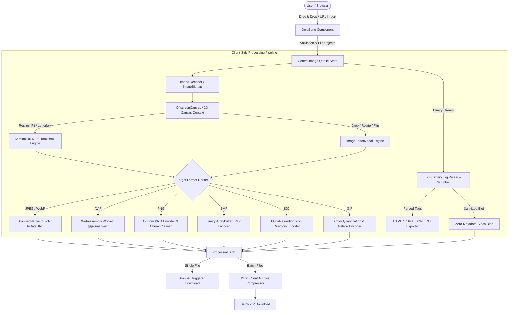
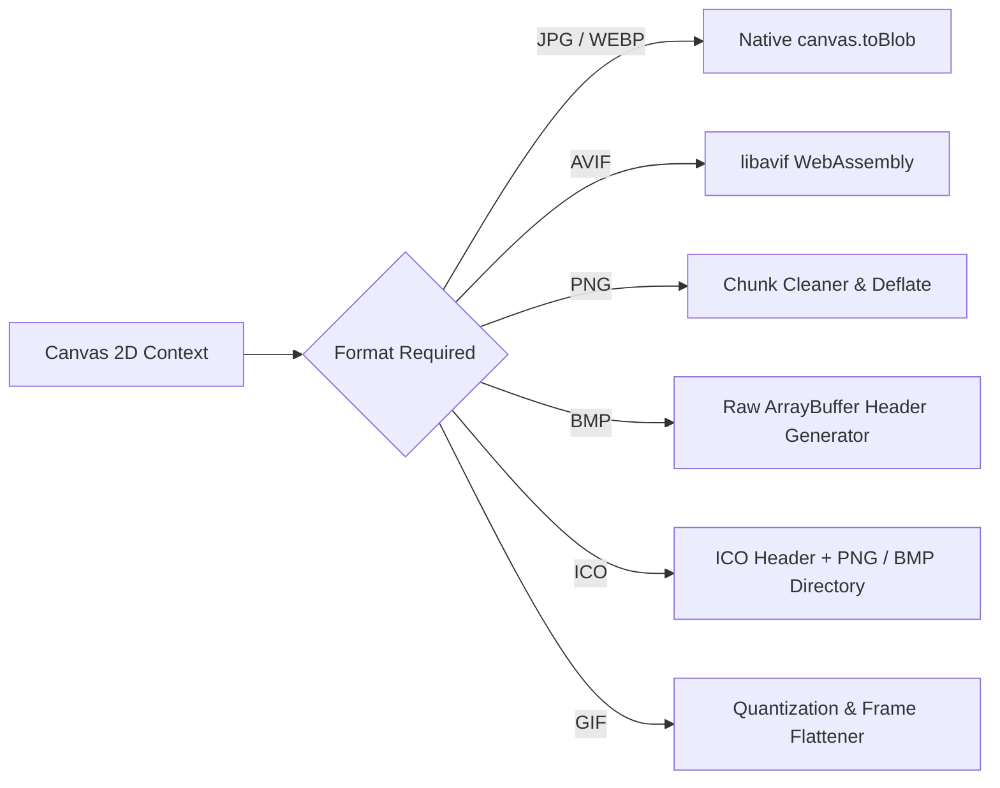

# System Architecture & Technical Specifications

## Project: imagetooltip (Free Picture & Image Converter)
**Domain:** [https://free-picture-converter.netlify.app](https://free-picture-converter.netlify.app)  
**Architecture Style:** 100% Client-Side Single Page Application (SPA) with WebAssembly & Web Workers  
**Version:** 1.0.0  

---

## 1. High-Level System Architecture

imagetooltip is engineered entirely as an in-browser application. There are zero backend processing servers, API endpoints for image manipulation, or persistent databases storing user files. All compute happens inside the user's browser sandbox using modern Web APIs and compiled WebAssembly binaries.



---

## 2. Technology Stack & Key Dependencies

| Layer | Technology | Purpose |
| :--- | :--- | :--- |
| **UI Framework** | **React 19** (`react`, `react-dom`) | Modern component architecture, hooks-based reactivity, concurrent rendering. |
| **Language** | **TypeScript 5.8** | Complete static type safety across image metadata, canvas contexts, and codecs. |
| **Build & Dev Tool** | **Vite 8.3** with `@vitejs/plugin-react` | Instant HMR, optimized static assets packaging, tree-shaking, and rollup chunks. |
| **Styling** | **Tailwind CSS v4** (`@tailwindcss/vite`) | High-performance CSS engine with custom slate/brand color variables and native dark mode. |
| **WebAssembly** | **`@jsquash/avif`** (`v2.1.1`) | Native C-compiled libaom/libavif encoder compiled to WebAssembly with multithreaded workers. |
| **Archive Packaging** | **`jszip`** (`v3.10.2`) | Client-side compression of multiple output blobs into `.zip` archives. |
| **Iconography** | **`lucide-react`** | Lightweight, consistent SVGs for tools, actions, and status indicators. |
| **Animations** | **`motion`** + **`canvas-confetti`** | Smooth modal transitions, progress bar easing, and batch completion celebration effects. |
| **Internationalization** | **`i18next`** + **`react-i18next`** | Multi-lingual translation strings and browser language detection across 10 locales. |

---

## 3. Directory & Codebase Structure

```
c:\projects-m\img-converter\
├── public/
│   ├── favicon.svg             # Vector brand favicon
│   ├── robots.txt              # Auto-generated crawler instructions
│   └── sitemap.xml             # Auto-generated canonical URL index
├── scripts/
│   └── generate-sitemap.js     # Build-time SEO sitemap generator
├── src/
│   ├── components/             # Reusable UI components
│   │   ├── icons/              # Custom brand SVGs (ExifIcon, etc.)
│   │   ├── CompareSlider.tsx   # Side-by-side before/after split viewer
│   │   ├── DropZone.tsx        # File drag-and-drop & URL modal trigger
│   │   ├── Footer.tsx          # Global responsive footer with links & i18n
│   │   ├── Header.tsx          # Sticky navigation header & tool switcher
│   │   ├── ImageCard.tsx       # Standardized modular card for batch queues
│   │   ├── ImageEditorModal.tsx# Canvas cropper, rotator, and aspect constraint tool
│   │   ├── ImagePreviewModal.tsx# High-resolution modal inspector with download CTA
│   │   ├── LanguageSwitcher.tsx# Multi-lingual dropdown selector
│   │   ├── UploadProgressBar.tsx# Interactive file upload/inspection preloader
│   │   └── UrlImageModal.tsx   # Batch direct image link importer
│   ├── config/
│   │   ├── landingPages.ts     # Deep content configs for 7 programmatic SEO routes
│   │   └── seo.ts              # Global metadata, canonical URLs, JSON-LD schemas
│   ├── utils/                  # Core image processing & encoder engines
│   │   ├── avifEncoder.ts      # WebAssembly AVIF wrapper with fallback
│   │   ├── backgroundRemover.ts# In-browser AI matting & Chroma key engine
│   │   ├── bmpEncoder.ts       # Raw uncompressed BMP binary builder
│   │   ├── exifExporter.ts     # Metadata export to HTML, CSV, JSON, TXT
│   │   ├── exifRemover.ts      # Binary EXIF parser and header sanitizer
│   │   ├── formatSupport.ts    # Browser feature detection matrix (encode/decode)
│   │   ├── gifEncoder.ts       # Canvas frame to GIF encoder
│   │   ├── icoEncoder.ts       # Windows ICO directory binary generator
│   │   ├── imageProcessor.ts   # Core canvas resizing, fitting, and format dispatch
│   │   ├── pngEncoder.ts       # Chunk-level PNG filtering and compression
│   │   ├── rateLimit.ts        # Client-side hourly token bucket for contact forms
│   │   ├── security.ts         # XSS sanitization, safe filenames, CSP helpers
│   │   ├── seo.ts              # Dynamic <head> tag and JSON-LD DOM injector
│   │   ├── urlImageFetcher.ts  # Client-side image fetcher for URL import
│   │   └── zipExporter.ts      # Multi-blob JSZip downloader
│   ├── views/                  # Primary screen and tool controllers
│   │   ├── AboutView.tsx       # About company, mission, and client-side privacy
│   │   ├── CompressorView.tsx  # Intelligent Compressor with target size modes
│   │   ├── ContactView.tsx     # Netlify Form with honeypot & hourly rate limiter
│   │   ├── ConverterView.tsx   # Universal multi-format batch converter
│   │   ├── ExifRemoverView.tsx # Binary EXIF inspector, exporter, and sanitizer
│   │   ├── FaqView.tsx         # Comprehensive FAQ knowledge base
│   │   ├── HomeView.tsx        # Main hub with feature hero and tool landing grid
│   │   ├── PrivacyView.tsx     # Plain-English zero-data-retention privacy policy
│   │   ├── ResizerView.tsx     # Pixel/Percent dimension scaling with contain modes
│   │   └── ToolLandingView.tsx # Generic template for programmatic conversion pairs
│   ├── App.tsx                 # Client routing, history state sync, and SEO listener
│   ├── i18n.ts                 # Translation dictionary and language config
│   ├── index.css               # Design tokens, custom scrollbars, and Tailwind layers
│   ├── main.tsx                # React application entrypoint
│   └── types.ts                # TypeScript domain models and state types
├── doc/                        # Architectural documentation repository
├── package.json
├── tsconfig.json
└── vite.config.ts
```

---

## 4. Processing Lifecycle & Memory Management

### 4.1 Ingestion & File Loading
1. The user drops files onto `DropZone.tsx` or selects files via the file system input.
2. File validation executes client-side checking MIME type and size limits (`<= 50MB`, up to 20 files per queue).
3. Files are converted into temporary memory object URLs (`URL.createObjectURL(file)`).
4. An `ImageBitmap` or `HTMLImageElement` is loaded asynchronously to read intrinsic width, height, aspect ratio, and alpha transparency presence.

### 4.2 Canvas Manipulation & Transformation Pipeline
- **Resizing:** Target dimensions are determined based on pixel input or percentage ratio.
- **Aspect Ratio Locking:** Calculations maintain source ratio `targetWidth = Math.round(targetHeight * (origWidth / origHeight))`.
- **Fit Modes:**
  - `cover`: Canvas matches target dimensions; source image is center-scaled and cropped to fill canvas bounds.
  - `contain`: Canvas matches target dimensions; source image is scaled down to fit inside, and letterbox areas are filled with user-defined background color (e.g., `#ffffff`, `#000000`) or transparent fill.
  - `stretch`: Image is drawn directly using `ctx.drawImage(img, 0, 0, targetWidth, targetHeight)`.

### 4.3 Multi-Format Encoding Architecture



1. **AVIF WebAssembly (`@jsquash/avif`):**
   - Extracts raw pixel `ImageData` from the canvas.
   - Dispatches image data to a dedicated Web Worker running compiled `libavif`.
   - Returns compressed `.avif` bytes encapsulated in a `Blob`.
   - If WebAssembly or SIMD fails, falls back gracefully to WebP/JPEG encoding with a user warning.
2. **PNG Optimization (`pngEncoder.ts`):**
   - Strips non-critical ancillary metadata chunks (`tEXt`, `zTXt`, `iTXt`) while preserving `IHDR`, `IDAT`, and `IEND`.
3. **BMP Binary Encoder (`bmpEncoder.ts`):**
   - Constructs standard 54-byte BMP header (BITMAPFILEHEADER + BITMAPINFOHEADER) and encodes bottom-up 24-bit RGB or 32-bit RGBA pixel buffers.
4. **ICO Encoder (`icoEncoder.ts`):**
   - Constructs standard Windows Icon Directory headers supporting standard square dimensions (16x16, 32x32, 48x48, 64x64, 128x128, 256x256).

### 4.4 Memory Safety & Leak Prevention
Because browser tabs run in constrained memory environments (especially on mobile devices with `< 4GB` RAM), imagetooltip applies rigorous memory management:
- Every generated `previewUrl` or download blob URL is tracked in component state.
- Whenever a file is removed from the queue or replaced, `URL.revokeObjectURL(url)` is invoked immediately.
- On modal dismissal (`ImageEditorModal`, `ImagePreviewModal`), working canvas contexts are cleared (`ctx.clearRect`) and references nullified to invite immediate garbage collection.

---

## 5. Client-Side Routing & History State Synchronization

imagetooltip does not rely on heavy router libraries (such as `react-router-dom`), keeping the bundle minimal:
- **HTML5 History API (`window.history.pushState`):** Routes are clean, canonical URLs (`/converter`, `/png-to-jpg`, `/resize-image`, `/exif-remover`).
- **Synchronized Active Tab:** An `activeTab` state controls the mounted view, reacting seamlessly to browser Back/Forward navigation (`popstate` event listeners).
- **SEO & Canonical Synchronization (`src/utils/seo.ts`):** On every route change, `updateRouteSeo(slug)` automatically updates document `title`, `meta[name="description"]`, `canonical` link tag, Open Graph metadata, and JSON-LD structured schemas.

---

## 6. Build, Deployment & Static Edge Hosting

- **Hosting Platform:** Netlify Edge Network (Static CDN).
- **Build Command:** `npm run build` executes `node scripts/generate-sitemap.js && vite build`.
- **Zero Server Overhead:** All deployment assets are static HTML, CSS, JavaScript, WebAssembly (`.wasm`), and image vectors. Zero backend vulnerabilities, infinite scalability, and near-zero hosting cost.
